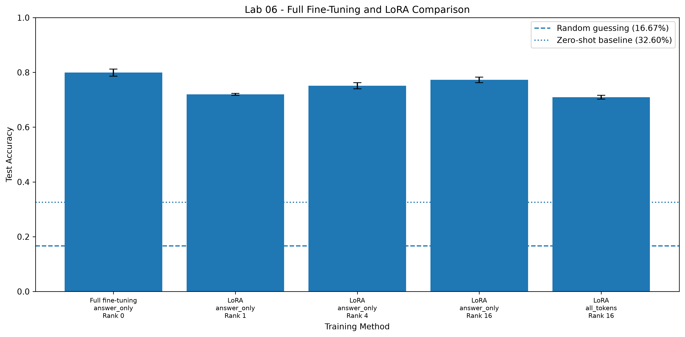

# AIGC 5500 – Lab 06: Fine-Tuning with LoRA

**Student:** Nouroz Ali  
**Student ID:** N10037086  
**Course:** Advanced Deep Learning – AIGC 5500  
**Model:** HuggingFaceTB/SmolLM2-135M  
**Dataset:** dair-ai/emotion

## 1. Introduction

In this lab, I worked with the SmolLM2-135M language model and the Emotion dataset. The main goal was to understand how fine-tuning works and compare full fine-tuning with LoRA.

I completed four parts:

1. Implemented answer-only loss and measured the zero-shot baseline.
2. Implemented LoRA from scratch and checked its parameter counts.
3. Compared full fine-tuning and LoRA using different ranks and random seeds.
4. Compared predicted and measured memory requirements for full fine-tuning and LoRA.

All experiments were run on a CPU-only environment.

## 2. Project Files

| File or folder | Description |
|---|---|
| `lab06_starter.py` | Original starter code provided for the lab. |
| `loss_and_baseline.py` | Implements answer-only labels, checks the loss positions, and measures zero-shot accuracy. |
| `lora_from_scratch.py` | Implements LoRA from scratch and checks its output and parameter counts. |
| `training_experiments.py` | Runs the learning-rate tests and fine-tuning experiments. |
| `memory_analysis.py` | Calculates and measures memory usage for full fine-tuning and LoRA. |
| `results/` | Contains experiment results, CSV files, JSON files, and the accuracy comparison figure. |
| `requirements.txt` | Lists the Python packages needed to run the project. |
| `.gitignore` | Excludes temporary files and unnecessary files from Git. |

## 3. Environment and Setup

The project was developed using Python 3.12.14 with Anaconda on Windows.

### Create and activate the environment

```bash
conda create -n ml-env python=3.12 -y
conda activate ml-env
```

### Install the required packages

```bash
python -m pip install -r requirements.txt
```

### Run the project

Run the following scripts from the project folder:

```bash
python loss_and_baseline.py
```

```bash
python lora_from_scratch.py
```

```bash
python training_experiments.py
```

```bash
python memory_analysis.py
```

The first run may take longer because the model and dataset need to be downloaded.

## 4. Part 1 – Answer-Only Loss and Zero-Shot Baseline

### Answer-only loss

I implemented an answer-only loss function. It assigns `-100` to prompt and padding positions so that these tokens are ignored when calculating the loss. Only the answer token is used for training.

I checked four examples and confirmed that each example had exactly one scored token. The prompt positions were ignored as expected.

**Result:** All answer-only loss checks passed.

### Zero-shot baseline

Before fine-tuning, I evaluated the original model on the test dataset.

| Measurement | Accuracy |
|---|---:|
| Zero-shot accuracy | 0.3260 (32.60%) |
| Random guessing | 0.1667 (16.67%) |
| Difference | 0.1593 (15.93 percentage points) |

The original model achieved 32.60% accuracy, which was higher than random guessing. This result provides a baseline for comparing the fine-tuned models.

## 5. Part 2 – LoRA Implementation

I implemented a LoRA linear layer from scratch. The implementation adds trainable low-rank matrices to a frozen linear layer.

I checked that:

- The initial LoRA output matches the original linear layer output when the adapter is initialized.
- The number of trainable parameters follows the expected formula.
- The LoRA weights can be merged into the original linear layer.
- The implementation agrees with the PEFT implementation on a small test.

All checks passed.

### LoRA parameter counts

The model has 134,515,008 original parameters. I counted the trainable parameters added to the query and value projection layers.

| Rank | q_proj parameters | v_proj parameters | Combined parameters |
|---|---:|---:|---:|
| 1 | 34,560 | 23,040 | 57,600 |
| 4 | 138,240 | 92,160 | 230,400 |
| 16 | 552,960 | 368,640 | 921,600 |

For rank 16, the combined LoRA adapters contain 921,600 trainable parameters. This is approximately 0.6852% of the original model's parameter count.

## 6. Part 3 – Fine-Tuning Experiments

### Experimental setup

I used the Emotion dataset with six classes:

- Sadness
- Joy
- Love
- Anger
- Fear
- Surprise

The experiment used 600 training examples and 500 test examples, with data seed 0.

I compared:

- Full fine-tuning with answer-only loss.
- LoRA rank 1 with answer-only loss.
- LoRA rank 4 with answer-only loss.
- LoRA rank 16 with answer-only loss.
- LoRA rank 16 with all-token loss.

Each main experiment was repeated using three random seeds: 0, 1, and 2.

### Learning-rate selection

I tested learning rates using the validation split before running the final experiments.

| Method | Learning rate | Validation accuracy |
|---|---:|---:|
| Full fine-tuning | 0.00001 | 0.700 |
| Full fine-tuning | 0.00005 | 0.774 |
| Full fine-tuning | 0.00010 | 0.810 |
| LoRA | 0.0003 | 0.694 |
| LoRA | 0.0010 | 0.730 |
| LoRA | 0.0030 | 0.720 |

I selected 0.0001 for full fine-tuning and 0.001 for LoRA based on the validation results.

### Accuracy results for each seed

| Method | Seed 0 | Seed 1 | Seed 2 | Mean accuracy |
|---|---:|---:|---:|---:|
| Full fine-tuning | 0.814 | 0.794 | 0.790 | 0.7993 |
| LoRA rank 1 | 0.722 | 0.716 | 0.722 | 0.7200 |
| LoRA rank 4 | 0.764 | 0.744 | 0.746 | 0.7513 |
| LoRA rank 16 | 0.770 | 0.764 | 0.784 | 0.7727 |
| LoRA rank 16, all-token loss | 0.716 | 0.702 | 0.710 | 0.7093 |

### Mean accuracy and standard deviation

| Method | Mean accuracy | Standard deviation |
|---|---:|---:|
| Full fine-tuning | 0.7993 | 0.0129 |
| LoRA rank 1 | 0.7200 | 0.0035 |
| LoRA rank 4 | 0.7513 | 0.0110 |
| LoRA rank 16 | 0.7727 | 0.0103 |
| LoRA rank 16, all-token loss | 0.7093 | 0.0070 |

### Accuracy comparison



### Discussion

Full fine-tuning achieved the highest mean accuracy at 79.93%. LoRA rank 16 achieved 77.27%, which was closer to full fine-tuning than ranks 1 and 4.

The results show that LoRA accuracy increased as the rank increased. Rank 1 had the lowest mean accuracy among the three LoRA ranks, while rank 16 performed the best.

All-token loss performed worse than answer-only loss for LoRA rank 16. Its mean accuracy was 70.93%, compared with 77.27% for answer-only loss. This suggests that including prompt tokens in the loss did not help the classification task in these experiments.

All tested methods performed better than the zero-shot baseline of 32.60% and the random guessing level of 16.67%.

There are some limitations to these results. The experiments used a relatively small training dataset and only three random seeds. The results may be different with more training examples, additional seeds, or different training settings.

## 7. Part 4 – Memory Analysis

For this part, I compared the predicted and measured memory requirements for full fine-tuning and LoRA rank 16.

The theoretical calculations use:

- 4 bytes per model parameter for float32 weights.
- 4 bytes per trainable parameter for gradients.
- 8 bytes per trainable parameter for the two Adam optimizer moments.

The predicted memory is calculated as:

- Weights = total parameters × 4 bytes
- Gradients = trainable parameters × 4 bytes
- Adam states = trainable parameters × 8 bytes

### Full fine-tuning

| Memory type | Predicted (MiB) | Measured (MiB) |
|---|---:|---:|
| Weights | 513.13 | 513.13 |
| Gradients | 513.13 | 513.13 |
| Adam states | 1026.27 | 1026.27 |
| **Total** | **2052.54** | **2052.54** |

### LoRA rank 16

| Memory type | Predicted (MiB) | Measured (MiB) |
|---|---:|---:|
| Weights | 516.65 | 516.65 |
| Gradients | 3.52 | 3.52 |
| Adam states | 7.03 | 7.03 |
| **Total** | **527.20** | **527.20** |

### Memory comparison

The measured memory for model weights, gradients, and Adam optimizer states was:

- Full fine-tuning: 2052.54 MiB
- LoRA rank 16: 527.20 MiB

LoRA rank 16 reduced these memory requirements by approximately 74.31% compared with full fine-tuning.

The original model weights still need to be stored for LoRA, but they are frozen. Only the adapter parameters are trained. This greatly reduces the memory needed for gradients and optimizer states.

### Predicted versus measured memory

The predicted and measured values matched in these experiments. This is because the calculation and measurement both count the model weights, gradients, and optimizer state tensors.

These values do not include activation memory or temporary buffers used during training.

I ran five training steps for each method to initialize the optimizer states and measure memory usage. These short runs were for memory measurement, not for comparing model accuracy.

### GPU memory limitation

The experiments were run on a CPU-only environment. Therefore, CUDA peak GPU memory was not available and could not be measured.

The memory results are saved in:

- `results/memory_analysis.csv`
- `results/memory_analysis.json`

## 8. Results Files

The `results` folder contains the saved outputs from the experiments.

| File | Description |
|---|---|
| `learning_rate_validation.csv` | Validation results for learning-rate selection. |
| `training_results.csv` | Results for individual training runs. |
| `training_results.json` | Training results in JSON format. |
| `experiment_summary.csv` | Mean accuracy and standard deviation for each method. |
| `accuracy_comparison.png` | Accuracy comparison figure. |
| `memory_analysis.csv` | Predicted and measured memory results. |
| `memory_analysis.json` | Memory results in JSON format. |

## 9. Conclusion

In this lab, I compared full fine-tuning with LoRA using the SmolLM2-135M model and the Emotion dataset.

Full fine-tuning achieved the highest mean accuracy, but LoRA rank 16 came close while using fewer trainable parameters. Increasing the LoRA rank improved accuracy in my experiments. I also found that answer-only loss performed better than all-token loss for LoRA rank 16.

The memory analysis showed that LoRA rank 16 reduced the memory used for weights, gradients, and Adam optimizer states by approximately 74.31% compared with full fine-tuning.

Overall, this lab helped me understand the differences between full fine-tuning and LoRA, how the loss calculation affects training, and how parameter-efficient fine-tuning can reduce memory requirements.

